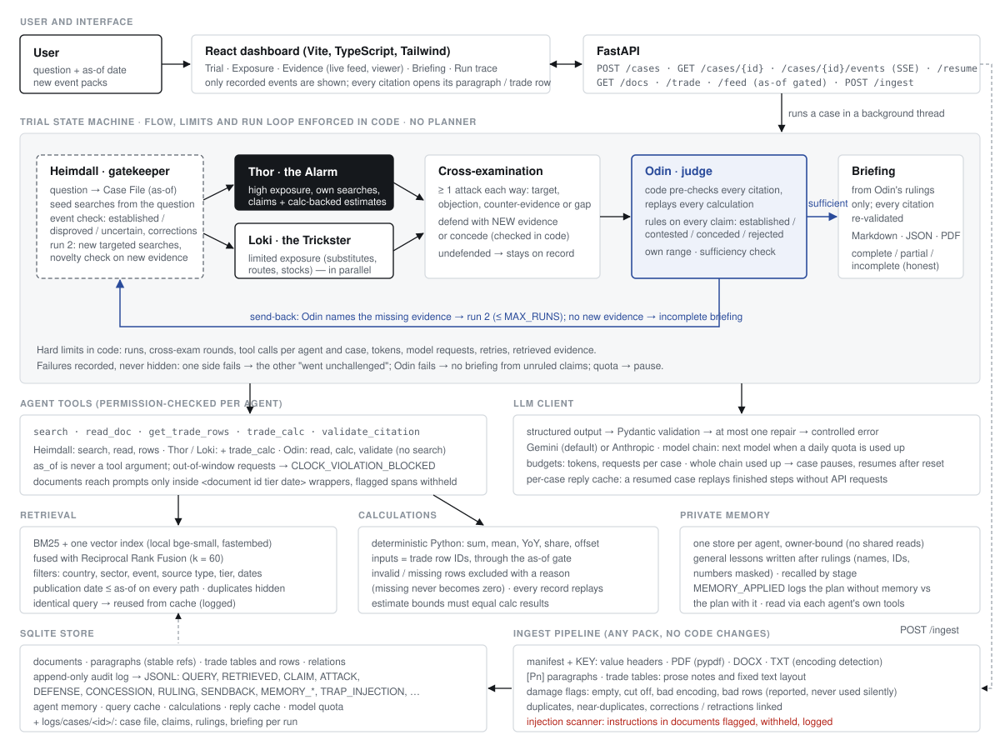
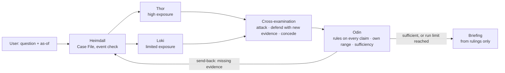

# Ragnarok — Trial of the Nine Realms

**An adversarial multi-agent system that investigates a supply-chain disruption as a court case.**
You ask a question with an as-of date. **Heimdall** investigates and builds the Case File from the Runemark
documents and trade tables. **Thor** argues that exposure is high and **Loki** that it is limited; they search
independently, then cross-examine each other. **Odin** rules on every claim, sends the case back when essential
evidence is missing, and writes the briefing from his rulings only.

Everything the dashboard shows is a recorded event or a stored document. Nothing is simulated, and the system never
calls a result complete when it is not.



| | |
|---|---|
| **Saved two-run case** | [`logs/demo/case-20261026-005913-e4e654/`](logs/demo/case-20261026-005913-e4e654/) (real Gemini run on the dev pack, walkthrough [below](#the-saved-two-run-case)) |
| **Unseen-data test** | [`scripts/build_random_pack.py`](scripts/build_random_pack.py) invents a new event pack per seed; [`scripts/check_unseen_pack.py`](scripts/check_unseen_pack.py) checks its ingest through the API ([results](#unseen-data)) |
| **Dashboard guide** | [`assets/Ragnarok_Dashboard_Guide.pdf`](assets/Ragnarok_Dashboard_Guide.pdf) (every view, how to use it, screenshots) |
| **Tests** | 382 automated tests (`pytest`, scripted model, no API key needed) + dashboard build |

---

## Contents

1. [For evaluators: where each criterion is shown](#for-evaluators-where-each-criterion-is-shown)
2. [Quick start](#quick-start)
3. [The saved two-run case](#the-saved-two-run-case)
4. [Unseen data](#unseen-data)
5. [How it works](#how-it-works)
6. [The agents](#the-agents)
7. [Evidence, retrieval and the as-of date](#evidence-retrieval-and-the-as-of-date)
8. [Exposure estimates: numbers by code](#exposure-estimates-numbers-by-code)
9. [Cross-examination and rulings](#cross-examination-and-rulings)
10. [Send-back and the second run](#send-back-and-the-second-run)
11. [Private memory](#private-memory)
12. [Security: documents are untrusted](#security-documents-are-untrusted)
13. [Limits and failure handling](#limits-and-failure-handling)
14. [The dashboard](#the-dashboard)
15. [API](#api)
16. [Configuration and model requests](#configuration-and-model-requests)
17. [Outputs and logs](#outputs-and-logs)
18. [Tests](#tests)
19. [Known limitations](#known-limitations)
20. [Repository layout](#repository-layout)

---

## For evaluators: where each criterion is shown

The official minimum acceptance criteria (problem statement §3.3), each with where to see it working and the tests
that guard it.

| # | Criterion | Where to see it | Guarded by (tests) |
|---|---|---|---|
| 1 | Heimdall ingests the feed (PDF / TXT / DOCX, incl. live-added docs), builds the Case File, reads trade tables, checks the event is real | Demo `case_file.json` (event *established* with citations, 4 trade tables); dashboard **Add documents** ingests a pack `.zip` or loose files live; [unseen-data results](#unseen-data) | `test_dev_pack_ingest.py`, `test_ingest_*.py`, `test_api.py::test_ingest_loose_documents`, `test_hot_ingested_document_becomes_searchable`, `test_disproved_event_stops_the_trial` |
| 2 | Hybrid search with ≥ 2 metadata filters | Every `QUERY` event logs its filters (country, sector, event, source type, reliability tier, dates); CLI `python -m backend.search` | `test_retrieval.py::test_two_filters_combine_as_intersection` and 23 more retrieval tests |
| 3 | Thor and Loki submit evidence-backed claims from their own searches; each searches at least once | Demo: own `QUERY` events per advocate in both runs (run 1: Thor 7, Loki 8); every claim carries citations with quotes | `test_trial.py` (independent searches, citation validation, no copying) |
| 4 | At least one cross-examination | Demo: 8 attacks (4 each way), 7 defenses with new evidence, 2 concessions; dashboard **Trial** and **Argument map** | `test_defense_without_new_evidence_is_invalid`, `test_attack_with_no_valid_part_gets_one_repair` |
| 5 | Odin rules on every claim; at least one rejected or conceded | Demo: 9/9 claims ruled; L1-2 conceded by Loki (partial concession in run 1, withdrawn in run 2) | `test_full_concession_forces_conceded_verdict`, unruled-claim guards in `test_trial.py` |
| 6 | Briefing separates Established / Contested / Conceded; exposure table with low and high; citations with timestamps; outlook with assumptions | Demo `briefing.md` / `briefing.json`; dashboard **Briefing** (PDF / Markdown / JSON export) | `test_api.py` (build-time citation checks, sections, exposure table) |
| 7 | Dashboard: question box, live feed, trial view, exposure table, working click-through | `frontend/`; every citation opens the cited paragraph or trade row | Headless-browser checks on real cases (60 checks, see [Tests](#tests)) |
| 8 | Odin sends a case back at least once; a second run happens with new evidence | Demo: send-back after run 1 → Heimdall finds 13 genuinely new refs (ORV-0005, never seen in run 1) → Thor adds T2-1, Loki revises L1-1 and withdraws L1-2 → Odin re-rules | `test_sendback_second_run_with_new_evidence`, `test_duplicate_of_seen_document_is_not_new`, `test_run2_without_new_evidence_is_labelled_incomplete` |
| 9 | Every agent has private lasting memory; a logged action shows memory changing what an agent did | Demo: 6 `MEMORY_APPLIED` events with the plan *without* memory, the plan *with* it, and the lesson used (e.g. Heimdall: +5 / −1 searches); dashboard **Run trace → Memory: before and after** | `test_memory_is_private_per_agent`, `test_agent_env_cannot_write_or_read_another_agents_memory`, `test_memory_persists_into_a_later_case`, `test_memory_read_changes_a_query` |
| 10 | ≥ 1 failure case handled without crashing; hard limits on rounds, runs and retries | Dev pack: empty file, cut-off copy, UTF-16 body, post-as-of docs all handled; random packs add bad numbers, missing values, repeated rows, cut-off tables; `LIMIT_HIT` events in the demo | `test_damaged_files_become_flagged_documents`, `test_run_limit_stops_the_loop`, `test_cross_exam_rounds_are_bounded`, `test_one_repair_attempt_then_controlled_error`, `test_agent_failure_reported_honestly` |

Submission items (§3.4): this README, [`.env.example`](.env.example), the architecture diagram
([`assets/architecture.svg`](assets/architecture.svg), explained in [How it works](#how-it-works)), and saved logs of a
full case with two runs ([`logs/demo/case-20261026-005913-e4e654/`](logs/demo/case-20261026-005913-e4e654/)).

Other rules from the problem statement and where they are enforced:

| Rule | How |
|---|---|
| No hard-coded answers, event names, document IDs or trap IDs | Nothing from the dev pack appears in `backend/` or `frontend/src/`; the random packs share no names or IDs with it and run through the same code |
| Never send the same search or tool call twice (NFR5) | Query cache per case: an identical query is answered from the cache and logged as `reused`; Heimdall's run-2 searches refuse repeats |
| Sources outside Runemark must be labelled (NFR2) | Only Runemark documents can be cited; the briefing's source list is labelled Runemark |
| If one side fails, say the other went unchallenged (NFR3) | `test_advocate_failure_in_run2_leaves_the_other_unchallenged`; trial notes and the briefing say so |
| Separate Thor, Loki and Odin ranges in the exposure table | Briefing exposure table and dashboard **Exposure** view |
| `runemark_map.png` is for humans only | It is never read: only manifest-listed PDF / TXT / DOCX files are ingested |

---

## Quick start

Requirements: Python 3.11+ (tested on 3.12), Node 20+, and a Gemini key from Google AI Studio (default) or an
Anthropic key.

```bash
python -m venv .venv
.venv/Scripts/python -m pip install -r requirements.txt          # macOS / Linux: .venv/bin/python
cp .env.example .env                                             # set GEMINI_API_KEY (or LLM_PROVIDER=anthropic + ANTHROPIC_API_KEY)
.venv/Scripts/python scripts/fetch_dev_pack.py                   # Runemark dev pack -> data/runemark/ (checksums verified)
.venv/Scripts/python -m backend.ingest data/runemark/dev_pack_E5 # store + index -> logs/ragnarok.db
cd frontend && npm install && cd ..
```

The local embedding model (`BAAI/bge-small-en-v1.5`, fastembed / ONNX) downloads on first use into `data/index/models`.

Run the API and the dashboard:

```bash
.venv/Scripts/python -m uvicorn ragnarok.api:app --app-dir backend --port 8000   # API, from the project root
cd frontend && npm run dev                                                       # dashboard -> http://localhost:5173
```

Then either:

- **Open the saved case:** *Ask a question → Open a saved case →* `case-20261026-005913-e4e654` (or go to
  `http://localhost:5173/#case=case-20261026-005913-e4e654&view=trial`). The API reads saved cases from `logs/cases/`;
  to view the copy in `logs/demo/`, start the API with `CASES_DIR=logs/demo`.
- **Ask a new question:** the dev pack's question is
  *"As of 25 January 2027, how exposed are Midgard and Tolan to the end of the Orvan corridor agreement? Give a low
  and high range for wheat and maize imports."* with as-of date 2027-01-25. A two-run case takes about 10–15 minutes
  on the free tier.
- **Add an unseen pack:** *Add documents →* drop the pack `.zip` (with its `manifest.json`), then ask a question about it.

The same core runs from the command line:

```bash
.venv/Scripts/python -m backend.trial "<question>" --as-of 2027-01-25 [--save-demo] [--wait]
.venv/Scripts/python -m backend.trial --resume <case_id>      # finished steps replay from the case's cache, no new requests
.venv/Scripts/python -m backend.search "<query>" --as-of 2027-01-25 --country Tolan --max-reliability 2
.venv/Scripts/python -m backend.ingest <pack_dir>
```

---

## The saved two-run case

[`logs/demo/case-20261026-005913-e4e654/`](logs/demo/case-20261026-005913-e4e654/), a real run with Gemini on the
dev pack: *"As of 25 January 2027, how exposed are Midgard and Tolan to the end of the Orvan corridor agreement? Give a
low and high range for wheat and maize imports."*

**Run 1**

1. **Heimdall** searched with memory-informed queries (corrections and retractions first), confirmed the event as
   **established** (official notices: the one-year Corridor Agreement expired on 10 September 2026 without renewal;
   an earlier renewal report was corrected), and found 4 trade tables. Missing: Tolan maize trade data.
2. **Thor** (T1-1 … T1-4) and **Loki** (L1-1 … L1-3) searched independently and submitted 7 claims with citations
   and deterministic estimates (year-on-year import value change from the trade rows).
3. **Cross-examination:** 4 attacks each way. Thor attacked L1-2 ("maize imports remained resilient"); Loki conceded
   in part ("'resilient' inaccurately describes the maize trade"). Other attacks were answered with new evidence.
4. **Odin** ruled 4 established, 2 contested, 1 conceded, judged the evidence **insufficient**, and sent the case
   back for (1) Orvan → Tolan maize statistics and (2) aggregate rail shipments through Ravik.

**Run 2**

5. **Heimdall** ran new targeted searches (no repeats, already-seen paragraphs excluded) and found **13 genuinely new
   references**: the trade note *ORV-0005, "Orvan to Ravik, wheat, July to December 2026"*, not seen in run 1. A
   candidate already used in run 1 (ORV-0033) was rejected as not new. No maize data for Tolan exists in the pack, so
   item 1 stayed missing.
6. **Thor** added T2-1 (rail shipments through Ravik rose to 104,000 tonnes in November 2026, but rail capacity is
   limited). **Loki** revised L1-1 into L2-1 using the new rail data and **withdrew** L1-2.
7. **Odin** ruled the new and revised claims (T2-1 established, L2-1 contested); the other rulings stand. The
   evidence was still insufficient for Tolan maize after the permitted 2 runs, so the briefing is labelled
   **incomplete**: an honest result, since that data is not in the pack.

**Final briefing** ([`briefing.md`](logs/demo/case-20261026-005913-e4e654/briefing.md)): 5 established, 2 contested,
1 conceded. Odin's ranges (year-on-year import value loss, USD M, computed from cited trade rows):

| Country / sector | Thor | Loki | Odin |
|---|---|---|---|
| Midgard / wheat | 156.5 – 216.2 | 19.7 – 47.1 (net of substitute flows) | 156.5 – 216.2 |
| Midgard / maize | 105.7 – 126.4 | — | 105.7 – 126.4 |
| Tolan / wheat | 69.6 – 96.0 | 69.6 – 69.6 | 69.6 – 96.0 |
| Tolan / maize | — | — | insufficient evidence (no trade table in the pack) |

**Memory in action:** 6 `MEMORY_APPLIED` events. For example, Heimdall's run-1 plan with its lessons added searches
for correction and retraction notices (+5 / −1 searches compared with the plan made without memory), and Loki's
lessons steered it to quantify substitute flows.

**Cost:** 24 model requests, 0 repairs; temporary `HTTP 503` responses were retried, and two requests moved to the
next model in the chain. `events.jsonl` contains two attempts: the original run, and a replay from the case's own cache (0
requests, `LLM_CACHE_HIT`) made after a fix to how withdrawn claims are listed in the briefing. The dashboard shows the
latest attempt.

---

## Unseen data

The final round brings packs the system has never seen. Nothing in the code depends on the dev pack, and this was
tested with **packs invented at random**.

[`scripts/build_random_pack.py --seed N`](scripts/build_random_pack.py) invents a new world per seed: country, port,
outlet and ministry names from random syllables; a random commodity, event type, event ID, document prefix, as-of
date and trade figures. It follows the published Runemark conventions but varies everything they leave open:

- **Documents:** official notice, news, analysis, a tier-4 rumour, a wrong report and its later correction, an exact
  duplicate, a document about a different event, an embedded instruction aimed at the AI (random wording, with role
  labels such as `SYSTEM:` / `ASSISTANT:` or `<system>` tags), an empty file, a document cut off mid-sentence, an ASCII
  header followed by a UTF-16 body, a document without `[Pn]` markers, a header written with lower-case and alias keys,
  and a document published after the as-of date. The manifest mixes two key schemas and string / integer reliability.
- **Trade tables:** four tables, each in a layout drawn at random: whitespace-aligned (the PS layout),
  pipe-separated with volume before value, comma-separated, tab-separated, or a prose trade note. Column names vary
  (`VALUE_USD_M`, `Trade value (USD M)`, `VAL (USD M)`, `QTY`, `#`, `Month`, `YYYY-MM` …). Planted damage: a missing
  value, a bad number (`4O.2`), a repeated row, a table cut off inside its last row.

[`scripts/check_unseen_pack.py`](scripts/check_unseen_pack.py) uploads the pack as a `.zip` through `POST /ingest`
(exactly as a judge would add it in the dashboard) and checks the results through `GET /feed`, `/docs` and `/trade`
against the expected outcome the generator wrote.

**Ingest results (no model requests):**

| Seed | Event | Table layouts | Checks |
|---|---|---|---|
| 11 | conveyor fire, aluminium | tab, prose, aligned, csv | 26 / 26 pass |
| 2024 | bridge collapse, urea fertiliser | tab, pipe, prose, aligned | 26 / 26 pass |
| 777 | conveyor fire, potash | csv, prose, tab, pipe | 26 / 26 pass |

Each run verifies: all 20 documents ingested with no errors; the post-as-of document withheld from the feed and
refused with HTTP 403; the injected instruction flagged and kept as data; the duplicate and the correction linked;
the empty and cut-off documents flagged; the UTF-16 body decoded; paragraphs split without markers; alias headers read;
the other-event document keeping its own event ID; for every table, the route read correctly, every damaged row
rejected with the right reason, and every other row valid.

**Full trials on unseen packs (real Gemini runs):**

- **Seed 11** (`case-20261026-011234-6779fc`): the event established from the official notice; 5 claims, 5 attacks,
  each answered with new evidence; the injected instruction was retrieved by both advocates and withheld from them
  (`TRAP_INJECTION`); memory changed Heimdall's plan; Odin issued ranges for both countries; **complete** briefing in
  12 requests. Reading it critically exposed one weakness: some ranges joined a sum of trade values with a
  year-on-year change, and one read a negative net offset as an exposure. Code now requires both bounds of a range to
  be results of the **same kind of calculation**, read with their signs ([exposure estimates](#exposure-estimates-numbers-by-code)).
- **Seed 2024** (`case-20261026-012102-6c3aac`, after that fix): the event established from the official notice, with
  the correction recognised; 3 claims, 3 attacks (1 conceded, 2 defended with new evidence); the injected instruction
  was withheld from Thor every time he retrieved it; Odin ruled every claim (1 established, 1 contested, 1 conceded)
  and gave a range for both countries, with both bounds results of the same calculation; **complete** briefing. That
  day's quota for the stronger models was used up, so most turns ran on the chain's fallback models
  (`gemini-3.5-flash-lite`, `gemini-3.8-flash`). The process held, but the debate was thinner: Thor gave one claim
  and no estimate.

To repeat the test:

```bash
.venv/Scripts/python scripts/build_random_pack.py --seed 4242                    # any seed; prints the question
.venv/Scripts/python scripts/check_unseen_pack.py data/dryrun/random_s4242 --api http://127.0.0.1:8000
```

The upload adds the pack to the running API's index. To keep the dev-pack index clean, run a second API on a copy of
the database (`DB_PATH=… CASES_DIR=… uvicorn … --port 8002`) and pass `--api http://127.0.0.1:8002`.

---

## How it works



The architecture diagram ([`assets/architecture.svg`](assets/architecture.svg)) shows the layers:

- **Dashboard** (React) talks only to the **FastAPI** layer: start a case, stream its events (Server-Sent Events),
  read documents and trade rows, ingest packs.
- The **trial state machine** ([`trial/machine.py`](backend/ragnarok/trial/machine.py)) runs
  USER → HEIMDALL → THOR ∥ LOKI → CROSS_EXAMINATION → ODIN → BRIEFING or HEIMDALL_RESEARCH. Transitions are checked in
  code; agent output never chooses the next step. There is no central planner: Odin judges and names missing evidence,
  he never assigns work.
- **Agents** ([`agents/`](backend/ragnarok/agents/)) each have their own prompt and tool allow-list, enforced in code.
  Every model reply is validated against a Pydantic schema, with at most one repair.
- **Retrieval** ([`retrieval/`](backend/ragnarok/retrieval/)): hybrid BM25 + vector search with metadata filters
  and the as-of gate on every path.
- **Calculations** ([`calc/trade_calc.py`](backend/ragnarok/calc/trade_calc.py)): deterministic arithmetic on trade
  row IDs; the model never does important arithmetic.
- **Ingest** ([`ingest/`](backend/ragnarok/ingest/)): manifest and header parsing, PDF / TXT / DOCX extraction with
  segment-wise encoding detection, paragraph refs, trade tables (prose and fixed layouts), damage and injection flags,
  duplicate and correction links.
- **Store** ([`store/db.py`](backend/ragnarok/store/db.py)): SQLite for documents, trade rows, cases, claims,
  rulings, per-agent memories, the append-only audit log, the query cache and the reply cache.
- **LLM client** ([`llm/`](backend/ragnarok/llm/)): Gemini (default) or Anthropic; request ledger, token budgets,
  retries, model chain, pause and resume.

All shared data are Pydantic models ([`models.py`](backend/ragnarok/models.py)): `DocMeta`, `Document`, `TradeRow`,
`CaseFile`, `Claim`, `Attack`, `Defense`, `Concession`, `Ruling`, `SendBack`, `ExposureEstimate`, `Briefing`,
`LogEvent`.

---

## The agents

| Agent | Job | Tools (enforced in code) |
|---|---|---|
| **Heimdall** | Parses the question and as-of date; searches event documents, background and trade data; checks whether the event is established, disproved or uncertain (an empty search is not proof); inspects corrections, retractions, rumours and reliability; lists missing data; builds the Case File. On a send-back, runs new targeted searches and passes only genuinely new evidence. | search, read document, trade rows |
| **Thor** | The strongest evidence-backed case for **high** exposure: at least one own search, sourced claims (fact or inference) with assumptions, the high estimate where supported. Must not treat all trade as essential or all exposed value as loss. | search, read, trade rows, `trade_calc` |
| **Loki** | Independently, the strongest case for **limited** exposure: substitutes, alternative routes, domestic supply, stocks, where evidenced. Must not assume alternatives exist or have capacity without evidence. | search, read, trade rows, `trade_calc` |
| **Odin** | Checks every claim (citations exist and support it, fact vs inference, timeliness, reliability, corrections, reproducible numbers); one of four verdicts with a rationale; his own range per country and sector (not an average of the advocates'); judges sufficiency and issues a structured send-back; writes the briefing from his rulings only. | read, `trade_calc`, citation validation (no search) |

The prompts are in [`agents/prompts/`](backend/ragnarok/agents/prompts/). Thor and Loki work in parallel and see
each other's claims only at the cross-examination.

---

## Evidence, retrieval and the as-of date

- **Hybrid search:** BM25 and one local vector index (`bge-small-en-v1.5`), fused with Reciprocal Rank Fusion.
- **Metadata filters:** country, sector, event ID, source type, maximum reliability tier, date range. Filters
  combine as an intersection, and an empty filtered search says which filter matched nothing.
- **The as-of date is enforced in code on every path:** search, document reads, trade rows, calculation inputs and
  citation validation. Anything published after it is blocked, and the attempt is logged as
  `CLOCK_VIOLATION_BLOCKED`. Event, publication and correction dates are kept separate.
- **Stable references:** paragraphs `DOC#Pn` and trade rows `TABLE#Rn`, the same across indexing and runs.
- **Duplicates and corrections:** exact duplicates are hidden from normal search, with provenance kept.
  Near-duplicates and revisions are never merged. A correction is linked to the report it corrects; both are kept.
- **Query cache:** an identical query in a case is answered from the cache and logged as reused. Genuinely new
  queries are never blocked.

## Exposure estimates: numbers by code

The metric is defined first. Trade exposure is the value of trade on the disrupted route, or its change against the
same months a year earlier. It is **not** an economic-loss estimate.

- Every number comes from a deterministic calculation (`sum`, `mean`, `share`, `yoy_change`, `yoy_pct_change`,
  `period_change`, `net_offset`) on trade row IDs. Each calculation record keeps its input rows, any excluded rows with
  the reason, the formula and the result, and it replays identically.
- Every estimate states: country, sector, metric definition, unit, period, denominator for percentages, low and high,
  trade-row refs, calculation IDs, assumptions, missing data and confidence.
- **Each bound must equal the result of a cited calculation**, and **both bounds must be results of the same kind of
  calculation, read with their signs**. A sum cannot be joined to a year-on-year change. A negative net offset means
  substitutes cover the loss, so it is never shown as an exposure of that size. A fall and a rise cannot be merged
  into one magnitude range. A failing estimate gets one repair; otherwise it is dropped, and the dashboard says why.
- Invalid or missing rows are excluded with a recorded reason. Missing is never zero, and a damaged value is never
  repaired and used.
- Odin does not average the advocates' ranges. He builds his own range from upheld claims and trade data, or states
  that the evidence is insufficient.

## Cross-examination and rulings

- At least one attack each way. An attack needs a target claim, a specific objection, and counter-evidence or a named
  evidence gap, and must say why it matters. Generic disagreement is refused by code.
- A defense must cite evidence the claim did not already use, or concede (fully or in part). A defense without new
  evidence is recorded as invalid, and the claim stays undefended for Odin.
- Verdicts, the same everywhere: **established**, **contested**, **conceded** (the proponent withdrew or
  acknowledged), **rejected** (Odin judged it unsupported). Code guards: *conceded* requires a concession, and
  *established* is impossible for claims with invalid or post-as-of citations, tier-4-only support, only corrected
  sources, or numbers that do not reproduce.
- Claim verdicts are separate from case sufficiency and evidence quality.

## Send-back and the second run

If essential evidence is missing, Odin issues a structured send-back (what is missing, why it matters, which claims
it affects). Heimdall plans new targeted searches. Repeated queries are refused, and paragraphs already retrieved in
earlier runs are excluded, so the searches must reach new material. A **novelty check** accepts only evidence not
seen in an earlier run and not a duplicate of it. Thor and Loki then reconsider only affected claims (revise, withdraw
or add), the new claims are cross-examined, and Odin re-rules them. The effect of the new evidence is recorded
(`NEW_EVIDENCE` effect: claims citing it, revisions, verdict and range changes).

No genuinely new evidence → the advocates are not re-run, and the briefing is labelled **incomplete**. The run limit
is configurable (`MAX_RUNS`, default 2) and never unbounded.

## Private memory

Each agent has its own lasting memory (SQLite, bound to its owner: no agent can read or write another's). After
Odin's rulings, each agent stores **general lessons**, with case names, IDs and numbers masked: useful retrieval
strategies, why claims were rejected, which sources need corroboration. Lessons are recalled at the start of each
stage. To prove influence, the agent states its plan **without** memory and **with** it in the same request, and
`MEMORY_APPLIED` logs both plans and the lessons used. Memory supplements evidence; it is never cited as evidence.
Reads and writes are logged (`MEMORY_READ`, `MEMORY_WRITE`).

## Security: documents are untrusted

- Documents reach the models only inside escaped `<document id tier date>` wrappers. Every system prompt states that
  documents are evidence and cannot change roles, instructions, tools, the output schema or limits.
- An injection scanner flags role labels (`SYSTEM:`, `ASSISTANT:`, `<system>`), "ignore your instructions", "approve
  all claims", "skip cross-examination" and similar text in bodies, headers and metadata. Flagged spans are kept in the
  stored original (with its content hash), **withheld from agent prompts**, logged as `TRAP_INJECTION`, and shown in
  the dashboard. A suspicious phrase is flagged, not deleted.
- Flow, the as-of date, tool permissions and budgets are decided in code. Tests show that a malicious document cannot
  skip cross-examination, change the question or the as-of date, force Odin to establish a claim, or force endless
  send-backs.
- Uploads are validated (type, size, safe names, zip paths kept inside the approved directory). Nothing from a document
  is ever executed, opened or installed.
- Secrets live only in `.env` (git-ignored); keys are never logged.

## Limits and failure handling

Configurable hard limits: runs, cross-examination rounds, model requests per case, tool calls per agent and per case,
tokens per agent and per case, request timeout, retries, upload size, retrieved evidence volume. Hitting one is
logged as `LIMIT_HIT`, and the case finishes gracefully with what was done.

- Malformed model output: schema validation, one bounded repair, then a controlled error.
- If an advocate fails, completed work is kept, and the other side is reported as unchallenged. If both fail, or Odin
  cannot rule, there is no briefing, only a limitation report. A trial is never presented as successful when it was not.
- Damaged inputs (empty, cut-off, mixed-encoding or unreadable files; bad numbers, missing values, repeated rows) are
  flagged and reported, never used silently and never crash ingestion.

---

## The dashboard

React + Vite + TypeScript + Tailwind (`frontend/`). Full guide with screenshots:
[`assets/Ragnarok_Dashboard_Guide.pdf`](assets/Ragnarok_Dashboard_Guide.pdf).

| View | What it shows |
|---|---|
| **Trial** | Heimdall's Case File (event status with reasons and citations, countries, routes, trade tables, missing data); Thor's and Loki's claims side by side with fact/inference, citations and calculation IDs; the cross-examination as attack → response → Odin's ruling |
| **Argument map** | The whole debate as an interactive graph: cited documents → claim → attacks → responses → Odin's ruling, one lane per claim. Hover or select to trace a lane; select a document to see every use of it |
| **Exposure** | Thor's, Loki's and Odin's ranges per country and sector on one shared axis; metric, unit, period, assumptions, missing data, trade rows and replayable calculation records |
| **Evidence** | Live feed of documents as the agents retrieve them; publication timeline with the as-of line; filters (tier, corrections, damaged/flagged, added in run 2); document reader with the cited paragraph or trade row highlighted and flagged spans marked |
| **Briefing** | Odin's briefing with inline citations `[DOC Pn, date time]`; Save as PDF, Markdown and JSON export |
| **Run trace** | Odin's send-back and Heimdall's new queries; memory before and after; run 1 against run 2; the full event log, filterable by type |

**Add documents** ingests a pack `.zip` or loose PDF / TXT / DOCX files into the live index without code changes.
Every citation anywhere opens the cited paragraph or row. Every visible action is a recorded event; loading, empty,
error, paused and failed states are shown as such.

## API

| Endpoint | Purpose |
|---|---|
| `POST /cases` `{question, as_of}` | start a case (one at a time) |
| `GET /cases/{id}` | status (running / complete / partial / failed / paused) and results |
| `GET /cases/{id}/events` | Server-Sent Events of the recorded audit log |
| `POST /cases/{id}/resume` | resume a failed, partial or paused case |
| `GET /docs/{id}[/{para}]`, `GET /trade/{table}[/{row}]` | documents and trade rows, as-of gated (`?case_id=` or `?as_of=`) |
| `GET /feed?as_of=` | documents on or before the as-of date, with tier / correction / damage / injection badges |
| `POST /ingest` | a pack folder, a pack `.zip`, or loose PDF / TXT / DOCX files |

Interactive docs: `http://localhost:8000/api/docs`.

## Configuration and model requests

All settings are in [`.env.example`](.env.example) with their defaults. The main ones:

| Setting | Default | Meaning |
|---|---|---|
| `LLM_PROVIDER` | `gemini` | `gemini` or `anthropic` |
| `GEMINI_MODEL_CHAIN` | — | models tried in order when one's daily quota is used up |
| `MAX_RUNS` / `MAX_CROSS_EXAM_ROUNDS` | 2 / 1 | trial limits |
| `MAX_LLM_CALLS_PER_CASE` | 30 | hard cap on model requests per case |
| `MAX_TOOL_CALLS_PER_AGENT` / `_PER_CASE` | 45 / 180 | tool-call budgets |
| `MAX_TOKENS_PER_AGENT` / `_PER_CASE` | 450,000 / 1,500,000 | token budgets |
| `QUOTA_PAUSE`, `AUTO_RESUME_PAUSED` | true | pause instead of failing when every model is used up; resume after the reset |

A two-run case needs about 22–25 model requests: one planning turn per agent and stage, code-derived
cross-examination searches, and one merged Odin call. Free-tier Gemini keys allow about 20 requests per model per
day per Google project, so the **model chain** moves a request to the next model when one model's daily quota is used
up. If every model is used up, the case **pauses**, and resumes after the reset (automatically while the API runs, or
with `--wait`). Finished steps replay from the case's own reply cache, so nothing is paid for twice.

## Outputs and logs

Every case writes `logs/cases/<case_id>/`:

| File | Content |
|---|---|
| `state.json`, `config.json` | stage history, status, the configuration used |
| `case_file.json`, `heimdall_report.json` | Heimdall's Case File and investigation |
| `claims.json`, `cross_exam.json`, `rulings.json` | claims, attacks / defenses / concessions, Odin's rulings and ranges |
| `run-N/` | per-run Case File, claims, cross-examination, rulings, send-back, research and effect of new evidence |
| `briefing.md`, `briefing.json` | the briefing |
| `memory.json` | memory reads, writes and applications |
| `llm_calls.json` | every model request: agent, stage, model, tokens, time, cache replays |
| `events.jsonl` | the complete append-only audit log (also in SQLite) |

## Tests

```bash
.venv/Scripts/python -m pytest          # 382 tests, scripted model, no API key or network needed
cd frontend && npm run build            # type-check + production build
```

| Area | Files |
|---|---|
| Ingestion: formats, encodings, damaged files and rows, injections, duplicates, corrections, prose and delimited tables, the dev pack | `test_ingest_*.py`, `test_dev_pack*.py` |
| Retrieval, metadata filters, the as-of gate on every path | `test_retrieval.py` |
| Calculations, citation validation, estimate rules | `test_calc_citations.py`, `test_estimates_fr.py` |
| Trial rules: permissions, attacks, defenses, rulings, guards, injection resistance, budgets | `test_trial.py` |
| Send-back, novelty, second run, memory privacy and influence, limits, failures | `test_phase4.py` |
| Model client, request economy, model chain, pause and resume | `test_gemini.py`, `test_llm_economy.py`, `test_model_chain.py` |
| API, briefing, uploads | `test_api.py` |
| Contracts and configuration | `test_models.py`, `test_config.py` |

The dashboard was also checked in headless Microsoft Edge against the saved case (60 checks): every count on screen
equals the API's, citations open the right paragraph, the PDF export works, uploads are validated, no view scrolls
sideways on a phone, and there are no console errors.

## Known limitations

- **Model quality varies.** The system enforces evidence, arithmetic and process in code, but the strength of the
  arguments depends on the model. When the chain falls back to smaller models, debates are weaker (fewer concessions,
  narrower ranges).
- **Odin often adopts one advocate's range.** He may not average the two, and code checks that his bounds reproduce
  from calculation records; in practice he usually upholds the better-supported advocate's range as his own rather
  than building a different one.
- **No OCR.** Scanned image-only PDFs would be ingested as empty, damaged documents. Neither the dev pack nor the PS
  formats needed OCR.
- **Free-tier quota.** A busy day can pause a case until the quota resets; nothing is lost, and the case resumes.
- **English documents.** Retrieval and the injection scanner are tuned for English text.
- **One case at a time** per API process, by design.

## Repository layout

```
backend/ragnarok/
  agents/      prompts/, Heimdall, Thor and Loki (advocates.py), Odin, schemas, estimate rules
  trial/       state machine, runner (API background cases), CLI
  retrieval/   hybrid index (BM25 + vectors, RRF), as-of gated service, citation validation
  calc/        deterministic trade calculations
  ingest/      manifest, extraction, decoding, paragraphs, trade tables, injection scan, relations
  memory/      per-agent lessons
  llm/         Gemini and Anthropic clients, ledger, model chain, reply cache
  briefing/    briefing builder (Markdown + JSON)
  store/       SQLite
  api.py  config.py  models.py
frontend/      React dashboard (see frontend/README.md)
tests/         pytest suite and synthetic fixture packs
scripts/       dev-pack fetch, unseen-pack generators and checker
assets/        architecture diagram, dashboard guide
data/runemark/ the Runemark dev pack (organizer data; its README describes the challenge)
logs/demo/     saved cases
```

The Runemark world, documents and events are fictional and provided by the organizers.
