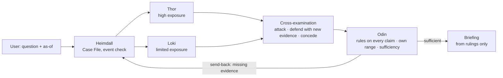

# Ragnarok — Trial of the Nine Realms

An adversarial multi-agent system that treats a supply-chain disruption as a court case. The user asks a question
with an as-of date; **Heimdall** builds and checks the Case File from the Runemark documents and trade tables,
**Thor** argues that exposure is high, **Loki** that it is limited, they cross-examine each other, and **Odin**
rules on every claim, sends the case back when evidence is missing, and writes the briefing from his rulings only.
Everything the dashboard shows is a recorded event or a stored document; nothing is simulated.


## How it works



- **No planner.** An explicit state machine (`backend/ragnarok/trial/machine.py`) runs
  USER → HEIMDALL → THOR ∥ LOKI → CROSS_EXAMINATION → ODIN → BRIEFING or HEIMDALL_RESEARCH (run 2). Transitions are
  checked in code; agent output never chooses the next step. Odin judges and names missing evidence; he never assigns work.
- **Each agent has its own prompt and tools** (`agents/prompts/`, `agents/common.py`): Heimdall search / read / trade
  rows; Thor and Loki also `trade_calc`; Odin read / calc / validate citations (no search). Permissions are enforced in code.
- **Evidence first.** Hybrid search (BM25 + one local vector index, fused with Reciprocal Rank Fusion) with metadata
  filters (country, sector, event, source type, reliability tier, dates). Every path enforces
  publication date ≤ as-of; blocked requests are logged as `CLOCK_VIOLATION_BLOCKED`.
- **Numbers by code, not by the model.** All sums, year-on-year changes and shares are deterministic calculations on
  trade row IDs (`calc/trade_calc.py`); every estimate bound must equal a calculation result, and every calculation replays.
  Invalid or missing rows are excluded with a reason, never treated as zero.
- **Debate rules in code.** At least one attack each way (target + specific objection + counter-evidence or an evidence
  gap). A defense must cite evidence the claim did not already use, or concede. Odin's verdicts:
  established / contested / conceded / rejected; "established" is impossible for claims with hard pre-check failures
  (invalid or post-as-of citations, tier-4-only support, only corrected sources, unreproducible numbers).
- **Second run.** If Odin judges the evidence insufficient he lists what is missing; Heimdall runs new targeted
  searches (repeats refused); a novelty check accepts only genuinely new evidence (not seen in run 1, not a duplicate).
  Thor and Loki then revise only affected claims; Odin re-rules the changed ones. No new evidence → the briefing says
  *incomplete*. Runs, rounds, tool calls, tokens, model requests and retries all have hard limits.
- **Private memory.** Each agent has its own lasting memory (SQLite, owner-bound). General lessons are written after
  Odin's rulings (case names, IDs and numbers masked) and recalled by stage; `MEMORY_APPLIED` logs the plan without
  memory, the plan with it, and the lesson used.
- **Documents are untrusted data.** They reach the models only inside escaped `<document id tier date>` wrappers;
  an injection scanner flags embedded instructions (stored, withheld from prompts, logged as `TRAP_INJECTION`). Flow,
  dates, tools and budgets are decided in code, so no document can skip cross-examination, change the question or force
  a ruling (tested).
- **Honest failures.** Damaged, empty or badly encoded documents and broken trade rows are flagged, reported and never
  used silently. If one advocate fails, the other is reported as unchallenged; if Odin cannot rule, there is no
  briefing. A case is never labelled complete when it is not.

## Requirements and setup

- Python 3.11+ (tested on 3.12.4), Node 20+ (tested on 25), Windows / macOS / Linux.
- An LLM key: Google AI Studio (Gemini, default) or Anthropic.

```bash
python -m venv .venv
.venv/Scripts/python -m pip install -r requirements.txt      # macOS/Linux: .venv/bin/python
cp .env.example .env                                         # then set GEMINI_API_KEY (or LLM_PROVIDER=anthropic + ANTHROPIC_API_KEY)
.venv/Scripts/python scripts/fetch_dev_pack.py               # Runemark dev pack -> data/runemark/ (checksums verified)
.venv/Scripts/python -m backend.ingest data/runemark/dev_pack_E5   # build the store and index (logs/ragnarok.db)
cd frontend && npm install && cd ..
```

The local embedding model (`BAAI/bge-small-en-v1.5`, fastembed / ONNX) downloads on first use into `data/index/models`.

## Run

```bash
# API (from the project root)
.venv/Scripts/python -m uvicorn ragnarok.api:app --app-dir backend --port 8000
# Dashboard (from frontend/) -> http://localhost:5173
npm run dev
```

In the dashboard: **Ask a question** (question + as-of date) or open a saved case; **Add documents** ingests a new
event pack (`.zip` with its `manifest.json`) or loose PDF / TXT / DOCX documents into the live index, with no code or
index edits. Views: **Trial** (Case File, Thor vs Loki, cross-examination, Odin's rulings), **Exposure** (Thor / Loki /
Odin ranges on one scale), **Evidence** (live feed, timeline, document viewer with the cited paragraph or trade row
highlighted), **Briefing** (findings, exposure table, outlook, citations with timestamps, sources; PDF / Markdown / JSON
export), **Run trace** (send-back, memory before/after, run 1 vs run 2, every recorded event).

Command line (same core as the API):

```bash
.venv/Scripts/python -m backend.trial "<question>" --as-of 2027-01-25 [--save-demo] [--wait]
.venv/Scripts/python -m backend.trial --resume <case_id>      # finished steps replay without new API requests
.venv/Scripts/python -m backend.search "<query>" --as-of 2027-01-25 --country Tolan --max-reliability 2
.venv/Scripts/python -m backend.ingest <pack_dir>
```

### API

| Endpoint | Purpose |
|---|---|
| `POST /cases` `{question, as_of}` | start a case (one at a time) |
| `GET /cases/{id}` | status (running / complete / partial / failed / paused) and results |
| `GET /cases/{id}/events` | Server-Sent Events of the recorded audit log |
| `POST /cases/{id}/resume` | resume a failed, partial or paused case |
| `GET /docs/{id}[/{para}]`, `GET /trade/{table}[/{row}]` | documents and trade rows, as-of gated (`?case_id=` or `?as_of=`) |
| `GET /feed?as_of=` | documents on or before the as-of date, with tier / correction / damage / injection badges |
| `POST /ingest` | a pack folder, a pack `.zip`, or loose PDF / TXT / DOCX files |

OpenAPI docs: `http://localhost:8000/api/docs`.

## Model requests and limits

A two-run case needs about 22 model requests (one planning turn per agent, code-derived cross-examination searches,
one merged Odin call). Free-tier keys allow about 20 requests per model per day, so `.env` can list a **model chain**
(`GEMINI_MODEL_CHAIN`): when one model's daily quota is used up, the next model answers the same request. If every
model is used up the case **pauses** and resumes after the reset (automatically while the API runs, or with `--wait`);
finished steps replay from the case's own reply cache. All limits are in `.env.example`.

## Outputs and logs

Every case writes `logs/cases/<case_id>/`: `state.json`, `case_file.json`, `claims.json`, `cross_exam.json`,
`rulings.json`, `briefing.md` / `briefing.json`, `run-N/` (per-run Case File, claims, rulings, send-back, research,
effect of new evidence), `memory.json`, `llm_calls.json` and `events.jsonl` (the complete audit log). Saved demo
cases are in `logs/demo/` (see [Demo](#demo)).

## Tests

```bash
.venv/Scripts/python -m pytest          # backend: scripted model, no API calls
cd frontend && npm run build            # type-check + production build
```

The tests cover ingestion (all formats, damaged files and rows, injections, duplicates, corrections), retrieval and
the as-of gate, calculations and citation checks, the trial rules (permissions, attacks, defenses, rulings, guards),
send-back and novelty, memory privacy and influence, limits and failures, prompt-injection resistance, the API, and
the model chain / pause / resume.

## Demo

*(filled in below with the saved two-run case and the unseen-pack dry run)*

## Repository layout

```
backend/ragnarok/   agents/ (prompts, Heimdall, Thor/Loki, Odin, schemas) · trial/ (state machine, runner, CLI)
                    retrieval/ (hybrid index, as-of gated service, citations) · calc/ · ingest/ · memory/ · llm/
                    briefing/ · store/ (SQLite) · api.py · config.py · models.py (Pydantic contracts)
frontend/           React + Vite + TypeScript + Tailwind dashboard (see frontend/README.md)
tests/              pytest suite and synthetic fixture packs
scripts/            dev-pack fetch and verification
data/runemark/      the Runemark dev pack (organizer data; its own README describes the challenge)
assets/             architecture diagram
logs/demo/          saved demo cases
```

The Runemark world, documents and events are fictional and provided by the organizers.
