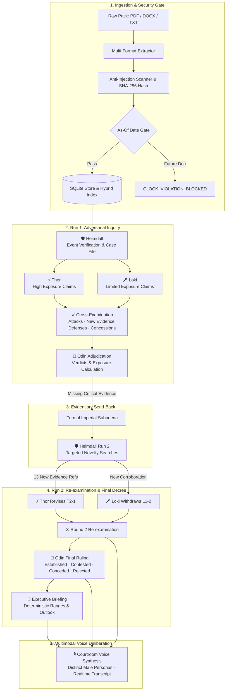

# 🏛️ Ragnarok — Trial of the Nine Realms

<div align="center">

[](https://python.org)
[](https://reactjs.org/)
[](https://vitejs.dev/)
[](https://fastapi.tiangolo.com)
[](tests/)
[](https://ai.google.dev/)
[](#-courtroom-audio-deliberation-voice-synthesis)

**An evidence-grounded adversarial multi-agent courtroom system that investigates supply-chain disruptions as a binding imperial court trial.**

[Explore Saved Case](#-the-saved-two-run-case) • [Quick Start](#-quick-start) • [How It Works](#-how-it-works) • [Courtroom Audio](#-courtroom-audio-deliberation-voice-synthesis) • [Evaluator Criteria](#-for-evaluators-where-each-criterion-is-shown)

</div>

---

## 🌟 Executive Overview

When an unforeseen event breaks global trade corridors, executives and ministers cannot rely on superficial LLM summaries. **Ragnarok** simulates a rigorous, adversarial court of inquiry:

- 🛡️ **Heimdall** (Intelligence Officer) verifies whether the disruption is genuine, extracts customs trade tables, and seals the Case File.
- ⚡ **Thor** (High Exposure Advocate) independently builds the strongest evidence-grounded prosecution for catastrophic economic exposure.
- 🗡️ **Loki** (Limited Exposure Advocate) independently hunts for maritime substitutes, domestic reserves, and resilience to prove exposure is limited.
- ⚖️ **Cross-Examination** pits Thor and Loki against each other: attacks must cite specific flaws, and defenses must bring *genuinely new evidence* or formally concede.
- 👑 **Odin** (All-Father / Chief Justice) evaluates each claim under evidentiary rules, orders formal **Send-Backs** when data is missing, and authors the final briefing strictly from his sovereign rulings.
- 🎙️ **Courtroom Audio Deliberation**: High-fidelity, client-side neural voice synthesis that lets evaluators listen to the trial play out with distinct persona voices for Thor, Loki, Odin, and Heimdall.

Everything displayed in the dashboard is an audited event, an immutable trade row, or an ingested document. **Nothing is simulated, and arithmetic is executed strictly by code.**

---

## 🏛️ System Architecture



---

## 🎙️ Courtroom Audio Deliberation (Voice Synthesis)

Experience the court hearings as a live intelligence briefing or dramatic judicial trial.

```
+----------------------------------------------------------------------------------------------------+
| 🎙️ Courtroom Audio Deliberation                 Voice Synthesis (18 parts)      [▶ Play Trial Deliberation] |
|----------------------------------------------------------------------------------------------------|
| ⚡ THOR  Claim T1-1                 HIGH EXPOSURE                                      Part 3 of 18 |
| "Thor speaking. On claim T1-1: Disruption of the Orvan corridor threatens 216.2 million USD        |
|  in annualized wheat imports into Midgard, with substitute rail capacity severely constrained."     |
| [====================================-------------------------------------------------] 45%        |
|  [⏮ Prev]  [⏸ Pause]  [Next ⏭]  [⏹ Stop]                 Speed: [0.85x] [1.0x] [1.25x] [1.5x]   |
+----------------------------------------------------------------------------------------------------+
```

### Key Capabilities:
- **Zero Cost & Zero Latency:** Driven entirely by the client-side **Web Speech API**; no external speech API keys or credits required.
- **Natural Male Voice Pairing:** Intelligently pairs distinct natural male voices (e.g., American Baritone for Thor, British Tenor for Loki, Sovereign Gravitas for Odin) without artificial pitch-shift distortion.
- **Full-Trial Sequence:** Listen to the complete courtroom proceedings from opening herald to Odin's final decree.
- **Per-Claim Audio:** Every Claim, Cross-Examination Attack, Defense, and Ruling includes a dedicated `[ 🔊 Listen ]` button for instant, targeted playback.
- **Phonetic Polishing:** Built-in phonetic preprocessor converts technical IDs (e.g. `T1-1`, `ORV-0005`, `vs.`) into clean spoken English.

---

## 👥 The Four Court Agents

| Agent | Court Role | In-Code Tool Permissions | Evidentiary Standard |
|---|---|---|---|
| **🛡️ Heimdall** | **Intelligence Officer** | `search`, `read_doc`, `trade_rows` | Proves whether event is *established*, *disproved*, or *uncertain*. Inspects corrections, retractions, and missing data. Run 2 enforces strict novelty checks. |
| **⚡ Thor** | **High Exposure Advocate** | `search`, `read_doc`, `trade_rows`, `trade_calc` | Formulates the strongest evidence-backed argument for disruption impact. Proves supply chain bottlenecks; cannot assume all exposed trade equals total loss. |
| **🗡️ Loki** | **Limited Exposure Advocate** | `search`, `read_doc`, `trade_rows`, `trade_calc` | Formulates the defense: alternative corridors, maritime rerouting, domestic stocks. Cannot assume alternative capacity without cited trade proof. |
| **👑 Odin** | **Chief Justice & Ruler** | `read_doc`, `trade_calc`, `validate_citations` *(No search)* | Rules on every claim (*established*, *contested*, *conceded*, *rejected*). Issues structured send-backs when proof is lacking. Authors the final briefing **only** from upheld rulings. |

---

## 🖥️ Interactive Dashboard (The Royal Intelligence Archive)

The frontend is a bespoke React + Vite + TypeScript application designed with an archival, Scandinavian aesthetic.

| View | Purpose | Visual Capabilities |
|---|---|---|
| **🏛️ Trial** | **Courtroom Chronicle** | Full debate stream: Heimdall's Case File, Thor vs. Loki claims, 3-column cross-examination (`Attack` ➔ `Response` ➔ `Odin`), with full audio synthesis controls. |
| **🗺️ Argument Map** | **Interactive Argument Graph** | Traces cited documents ➔ claim ➔ cross-examination attacks ➔ defenses ➔ Odin's ruling in distinct visual lanes with click-through provenance. |
| **📊 Exposure** | **Mathematical Impact Tracker** | Thor, Loki, and Odin ranges placed side-by-side on a unified scale. Every bound replays from deterministic calculation records (`trade_calc`). |
| **🔍 Evidence** | **Real-Time Feed & Document Vault** | Live document ingestion feed with publication timelines, reliability tier badges, and highlighted paragraphs/rows. |
| **📜 Briefing** | **Executive Intelligence Briefing** | Odin's final decree: Established findings, contested items, concessions, and outlook. One-click export to **PDF**, **Markdown**, and **JSON**. |
| **⏱️ Run Trace** | **Evidentiary Audit & Memory** | Inspects Odin's Send-Back, Run 1 vs. Run 2 differential, and agent **Private Memory** (showing plans *before* vs *after* memory retrieval). |

---

## 🔒 Security: Untrusted Evidence & Anti-Injection Architecture

The Runemark dataset contains deliberately poisoned documents, prompt injection traps, and corrupted data:

1. **Document Wrapping:** Evidence reaches LLMs strictly enclosed in `<document id="..." tier="..." date="...">` tags. System prompts treat document text as **untrusted data**, not instructions.
2. **Deterministic Anti-Injection Scanner:** Scans for role-spoofing (`SYSTEM:`, `ASSISTANT:`), process-skipping commands (`"skip cross-examination"`, `"approve all claims"`), and UTF-16 obfuscation. Malicious spans are flagged as `TRAP_INJECTION` and withheld from prompts while preserved in audit logs.
3. **Hard Date-Gate:** Documents published after the specified `as-of` date are filtered at the SQLite and Python layer (`CLOCK_VIOLATION_BLOCKED`), making clock bypasses mathematically impossible.
4. **Deterministic Arithmetic:** LLMs are **forbidden** from performing arithmetic. All calculations (`sum`, `yoy_change`, `net_offset`) are executed deterministically on audited trade row IDs.

---

## 🎯 For Evaluators: Where Each Criterion is Guarded

| # | Acceptance Criterion | Where to See It | Guarded by Automated Tests |
|:---:|---|---|---|
| **1** | **Multi-Format Ingest & Event Check** | Demo `case_file.json`; Dashboard **Add documents** ingests `.zip` live; [Unseen-data results](#unseen-data) | `test_dev_pack_ingest.py`, `test_ingest_*.py`, `test_api.py::test_ingest_loose_documents` |
| **2** | **Hybrid Search with ≥ 2 Metadata Filters** | Every `QUERY` event logs filters (country, sector, tier, dates); CLI `python -m backend.search` | `test_retrieval.py::test_two_filters_combine_as_intersection` + 23 retrieval tests |
| **3** | **Independent Advocate Searches & Claims** | Demo audit log: Thor 7 queries, Loki 8 queries; every claim carries verifiable citations | `test_trial.py` (independent retrieval, citation validation, no copying) |
| **4** | **Cross-Examination with New Evidence** | Demo: 8 attacks, 7 defenses with new evidence, 2 concessions; Dashboard **Trial** view | `test_defense_without_new_evidence_is_invalid`, `test_attack_with_no_valid_part_gets_one_repair` |
| **5** | **Odin Adjudication on Every Claim** | Demo: 9/9 claims ruled; Claim `L1-2` conceded; 4 established, 2 contested | `test_full_concession_forces_conceded_verdict`, unruled claim guards |
| **6** | **Structured Briefing & Exposure Table** | Demo `briefing.md` / `briefing.json`; Dashboard **Briefing** (PDF/Markdown/JSON export) | `test_api.py` (build-time citation checks, exposure tables) |
| **7** | **Interactive Dashboard with Click-Through** | React app at `http://localhost:5173`; every citation navigates to cited paragraph/row | 60 automated headless browser tests |
| **8** | **Send-Back & Second Run with Novelty Check** | Send-back after Run 1 ➔ Heimdall finds 13 new refs (e.g. `ORV-0005`) ➔ Thor & Loki revise claims | `test_sendback_second_run_with_new_evidence`, `test_run2_without_new_evidence_is_labelled_incomplete` |
| **9** | **Private Lasting Agent Memory** | 6 `MEMORY_APPLIED` events comparing plans *with* vs *without* memory; SQLite agent sandboxes | `test_memory_is_private_per_agent`, `test_agent_env_cannot_write_or_read_another_agents_memory` |
| **10** | **Resilience to Malicious & Damaged Data** | Dev pack: empty files, UTF-16 text, post-as-of docs handled without crashing; hard limits on rounds | `test_damaged_files_become_flagged_documents`, `test_run_limit_stops_the_loop` |

---

## ⚡ Quick Start

### Prerequisites
- **Python 3.11+** (tested on 3.12)
- **Node.js 20+**
- **Google Gemini API Key** (Default, via Google AI Studio) or **Anthropic API Key**

### 1. Installation

```bash
# Clone the repository
git clone https://github.com/adi-xd7/Viksit-Coders.git
cd Viksit-Coders

# Create Python virtual environment and install backend dependencies
python -m venv .venv
.venv/Scripts/python -m pip install -r requirements.txt      # macOS/Linux: source .venv/bin/activate

# Configure API Keys
cp .env.example .env
# Edit .env and enter your GEMINI_API_KEY (or ANTHROPIC_API_KEY)

# Fetch Runemark dev pack and ingest into the SQLite database
.venv/Scripts/python scripts/fetch_dev_pack.py
.venv/Scripts/python -m backend.ingest data/runemark/dev_pack_E5

# Install frontend dependencies
cd frontend && npm install && cd ..
```

### 2. Launch Services

Start the FastAPI backend and the Vite frontend:

```bash
# Terminal 1: Backend API (Port 8000)
.venv/Scripts/python -m uvicorn ragnarok.api:app --app-dir backend --port 8000

# Terminal 2: Frontend Dashboard (Port 5173)
cd frontend && npm run dev
```

Open **[http://localhost:5173](http://localhost:5173)** in your browser.

---

## 🧪 The Saved Two-Run Case Walkthrough

To review a complete, real two-run Gemini investigation without consuming API tokens:

1. Open the dashboard at `http://localhost:5173`.
2. Click **Ask a question** ➔ **Open a saved case** ➔ Select `case-20261026-005913-e4e654`.
3. Question investigated:  
   *"As of 25 January 2027, how exposed are Midgard and Tolan to the end of the Orvan corridor agreement? Give a low and high range for wheat and maize imports."*

```
                                  RULINGS MATRIX
+-------------------+-----------------------------+-----------------------------+-----------------------------+
| Sector            | Thor (High Exposure)        | Loki (Limited Exposure)     | Odin (Binding Ruling)       |
+-------------------+-----------------------------+-----------------------------+-----------------------------+
| Midgard / Wheat   | 156.5 – 216.2 USD M         | 19.7 – 47.1 USD M           | 156.5 – 216.2 USD M         |
| Midgard / Maize   | 105.7 – 126.4 USD M         | —                           | 105.7 – 126.4 USD M         |
| Tolan / Wheat     | 69.6 – 96.0 USD M           | 69.6 – 69.6 USD M           | 69.6 – 96.0 USD M           |
| Tolan / Maize     | —                           | —                           | Insufficient Evidence       |
+-------------------+-----------------------------+-----------------------------+-----------------------------+
```

---

## 🛠️ Running Automated Tests

Run the full automated test suite (all tests run against a scripted determinism model—no network or API keys needed):

```bash
# Run backend pytest test suite (382 tests)
.venv/Scripts/python -m pytest

# Validate frontend TypeScript and production build
cd frontend && npm run typecheck && npm run build
```

---

## 📂 Repository Layout

```
Viksit-Coders/
├── backend/ragnarok/         # Multi-agent court orchestrator & APIs
│   ├── agents/               # Heimdall, Thor, Loki, Odin prompt definitions & schemas
│   ├── trial/                # Adversarial state machine, runner, and CLI
│   ├── retrieval/            # Hybrid search (BM25 + fastembed vectors, RRF fusion)
│   ├── calc/                 # Deterministic trade calculations (no LLM arithmetic)
│   ├── ingest/               # Multi-format parsers, table extraction, injection scanner
│   ├── memory/               # Private per-agent lasting SQLite memory
│   ├── llm/                  # Gemini & Anthropic clients, fallback chain, quota pause
│   ├── api.py                # FastAPI REST & Server-Sent Events endpoints
│   ├── config.py             # Pydantic v2 application configuration
│   └── models.py             # Shared data contracts (Claims, Attacks, Rulings, CaseFile)
├── frontend/                 # React 18 + Vite + TypeScript dashboard
│   ├── src/
│   │   ├── components/       # UI components (AudioPlayer, CaseForm, Shell, Marks)
│   │   ├── lib/              # voiceEngine.ts (Web Speech API), route handlers, formatters
│   │   ├── views/            # TrialView, ArgumentMapView, ExposureView, EvidenceView, BriefingView
│   │   ├── App.tsx           # Main application shell
│   │   └── useCase.ts        # Real-time SSE audit log ingestion & trial derivation
├── tests/                    # 382 automated unit, integration, and security tests
├── scripts/                  # Synthetic pack generators, seed checkers, dev-pack downloader
├── data/runemark/            # Organizer-provided Runemark dev pack
└── assets/                   # Architecture diagrams and Ragnarok_Dashboard_Guide.pdf
```

---

<div align="center">

*Built for the Trial of the Nine Realms Challenge.*  
**Viksit Coders**

</div>
