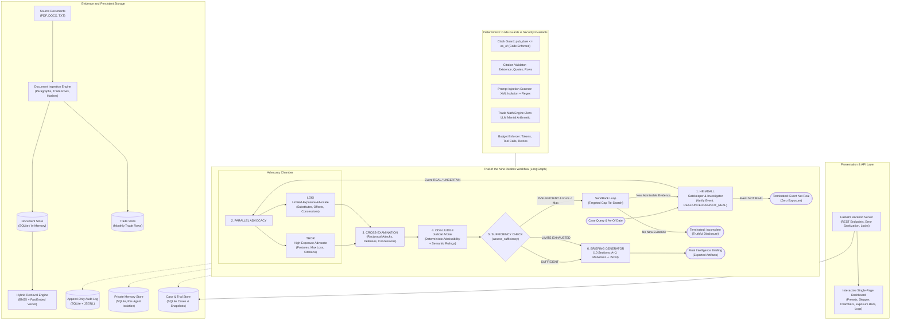

# RAGNAROK Architecture and System Design

## 1. System Overview

**Trial of the Nine Realms: Supply Chain Disruption Impact Analyzer** is an adversarial multi-agent courtroom system that investigates supply chain disruptions across the fictional Runemark world. Rather than producing generic summaries, four specialized AI agents collaborate, clash, and judge evidence within a bounded state machine.

---

## 2. Mermaid Architecture Diagram

---

## 3. Core Subsystems

### A. Document Ingestion & Verification
- **Multi-Format Extraction**: Ingests PDF (`pymupdf`), DOCX (`python-docx`), and TXT with multi-encoding fallbacks (`utf-8`, `utf-16le`, `latin-1`).
- **Paragraph Segmentation**: Splits into verifiable `[Pn]` paragraph markers with immutable refs.
- **Trade Row Extraction**: Synthesizes structured monthly trade volume and value tables.
- **Integrity & Security**: Computes SHA-256 content hashes, detects duplicates, scans for prompt injection strings, and handles damaged/empty files without crashing.

### B. Hybrid Evidence Retrieval
- **Lexical BM25 Ranking**: Uses `BM25Okapi` for keyword and identifier matching (e.g. treaty names, route numbers).
- **Dense Vector Similarity**: Leverages `FastEmbed` (`BAAI/bge-small-en-v1.5`) and an in-memory `QdrantClient`.
- **Fusion**: Fuses scores using Reciprocal Rank Fusion (RRF) with reliability-tier and country-sector metadata boosts.
- **Clock Constraint**: Strict `pub_date <= as_of` enforcement in Python code on every search path.

### C. The Four Courtroom Agents
1. **Heimdall** (`backend/agents/heimdall.py`): Gatekeeper and chief investigator. Evaluates disruption event reality (`REAL`, `UNCERTAIN`, `NOT_REAL`), parses queries, gathers foundational evidence, and manages targeted send-back re-search.
2. **Thor** (`backend/agents/thor.py`): High-exposure advocate. Generates claims with `posture="high"`, quotes primary sources, and models maximum commercial impact using deterministic calculations.
3. **Loki** (`backend/agents/loki.py`): Limited-exposure advocate. Argues mitigation through secondary rail routes, alternate suppliers, and domestic cushions. Generates explicit concessions (`Concession`) when evidence is unrefuted.
4. **Cross-Examination** (`backend/agents/cross_exam.py`): Manages structured clashes, attacks, and defenses between Thor and Loki, maintaining graceful degradation if an advocate fails.
5. **Odin** (`backend/agents/odin.py`): Chief judicial arbiter. Deterministically screens citations, issues binding rulings (`ESTABLISHED`, `CONTESTED`, `CONCEDED`, `REJECTED`), derives defensible exposure ranges from trade math, and evaluates case sufficiency.

### D. Judicial Briefing & Delivery
- **Validated Briefing**: Authors a 10-section intelligence report (Sections A through J) grounded exclusively in Odin's rulings.
- **Deterministic Math**: Sums, YoY growth, percentage shares, and route offset netting are computed in `backend/trade_calc.py`—never computed mentally by the LLM.
- **FastAPI & Dashboard**: Full REST API and real-time dashboard served at `http://localhost:8000/`.
